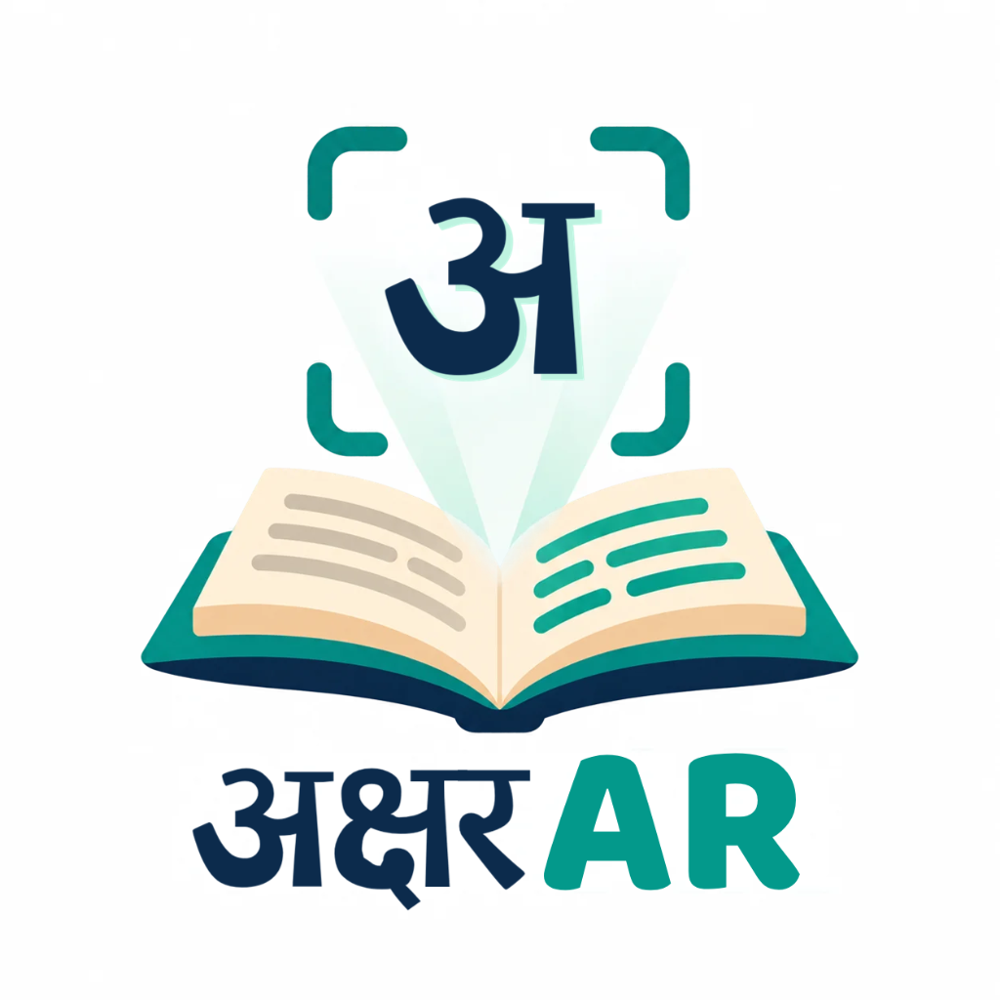
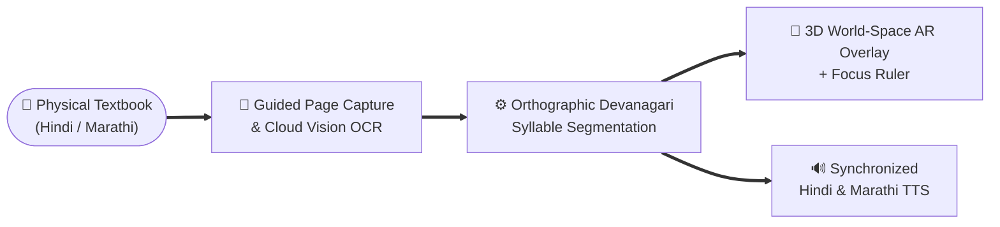

# AksharAR
### Devanagari-Centric AR Assistive Framework for Dyslexic Children

*Transforming physical Hindi and Marathi schoolbooks into interactive, dyslexia-friendly reading experiences through Spatial Augmented Reality.*

---

## Why AksharAR?

Most assistive reading tools for dyslexia are built exclusively for digital screens and Latin scripts. However, millions of children in India learn to read using **printed textbooks** in **Devanagari (Hindi & Marathi)**, where unique orthographic structures create severe visual crowding:

| The Devanagari Reading Barrier | How AksharAR Solves It |
| :--- | :--- |
| **Continuous Overhead Line (*Shirorekha*)** Fuses characters across an entire word into a single dense block. | **Alternating Syllable Chromatics** Visually separates adjacent syllables using high-contrast, color-blind safe palettes. |
| **Complex Conjuncts (*Samyuktaksharas*)** Half-consonants merged across *Halant* boundaries confuse phonetic decoding. | **Phonetic *Akshara* Segmentation** Keeps consonant clusters and vowel *matras* bound as intact pronounceable units. |
| **Static Printed Textbooks** Paper textbooks offer zero font customization, line spacing, or audio feedback. | **In-Situ Spatial AR & Speech** Projects stabilized 3D reading overlays and focus rulers directly over the physical page with tap-to-read speech. |

---

## Core Capabilities

<table>
  <tr>
    <td width="50%" valign="top">
      <h3>📱 Ergonomic Guided Capture</h3>
      
Designed around child-friendly Human-Computer Interaction (HCI) principles. Features an adjustable reading viewfinder for both short poetry stanzas and dense textbook chapters, paired with gentle posture and motion guidance for effortless scanning.

    </td>
    <td width="50%" valign="top">
      <h3>🧩 Devanagari Syllable Intelligence</h3>
      
Unlike standard character splitters that break Indic words apart, AksharAR understands Devanagari linguistics. It preserves conjunct clusters and vowel diacritics so every highlighted block matches a true spoken syllable (<i>Akshara</i>).

    </td>
  </tr>
  <tr>
    <td width="50%" valign="top">
      <h3>🥽 Pose-Stabilized Spatial AR</h3>
      
Anchors interactive reading lines and focus rulers right onto the physical textbook page in 3D space. Real-time spatial smoothing filters out natural hand tremors so the overlay stays steady while reading.

    </td>
    <td width="50%" valign="top">
      <h3>🔊 Multisensory & Adaptive Profiles</h3>
      
Pairs visual syllable segmentation with synchronized Hindi and Marathi Text-to-Speech (TTS). Learners can customize letter spacing, line height, background tints, and dyslexia-friendly Devanagari typography.

    </td>
  </tr>
</table>

---

## Phonetic *Akshara* Breakdown in Action

Instead of naive character-by-character splitting (which breaks half-letters and detaches vowel signs), **AksharAR** groups words into true pronounceable syllables:

| Printed Textbook Word | Naive Character Split (Broken) | AksharAR Syllable Overlay (Intact *Aksharas*) |
| :---: | :---: | :---: |
| **नमस्कार** | न + म + स + ् + क + ा + र | **`[ न ]`** • **`[ म ]`** • **`[ स्का ]`** • **`[ र ]`** 🔊 |
| **अक्षर** | अ + क + ् + ष + र | **`[ अ ]`** • **`[ क्ष ]`** • **`[ र ]`** 🔊 |
| **प्रार्थना** | प + ् + र + ा + र + ् + थ + न + ा | **`[ प्रा ]`** • **`[ र्थ ]`** • **`[ ना ]`** 🔊 |

---

## How It Works

1. **Frame & Scan:** Point the smartphone camera at any printed Hindi or Marathi page using the guided reading window.
2. **Linguistic Breakdown:** Detected lines are segmented into phonetically intact *Aksharas* and styled according to the child's accessibility profile.
3. **Read & Listen in AR:** Color-coded syllable cards and a focus ruler lock onto the physical page. Tap any word or line to hear clear native pronunciation while following along visually.

---

## Built With

---

## Team & Mentorship

- **Team Members:** Om Awadhoot, Lohit Bhaware, Atharv Patil, Parth Thakre
- **Project Guide:** Prof. Swati Tiwari
- **Location:** Nagpur, Maharashtra, India
